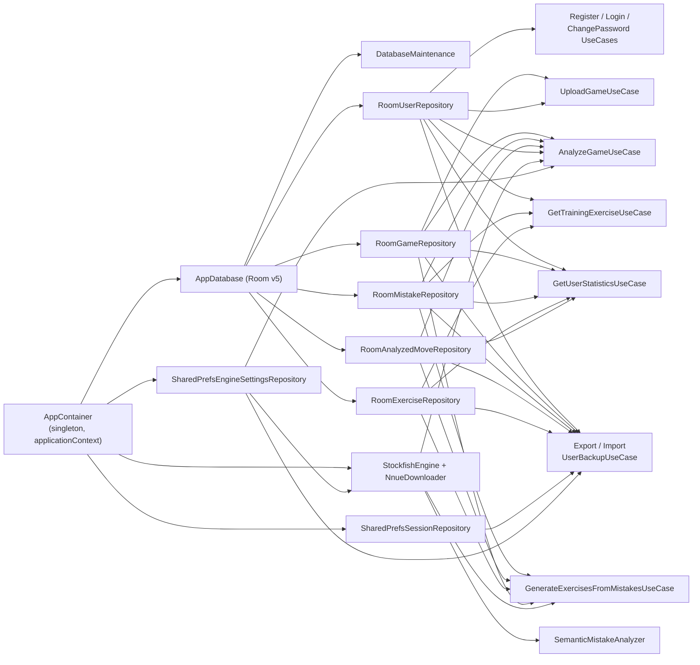
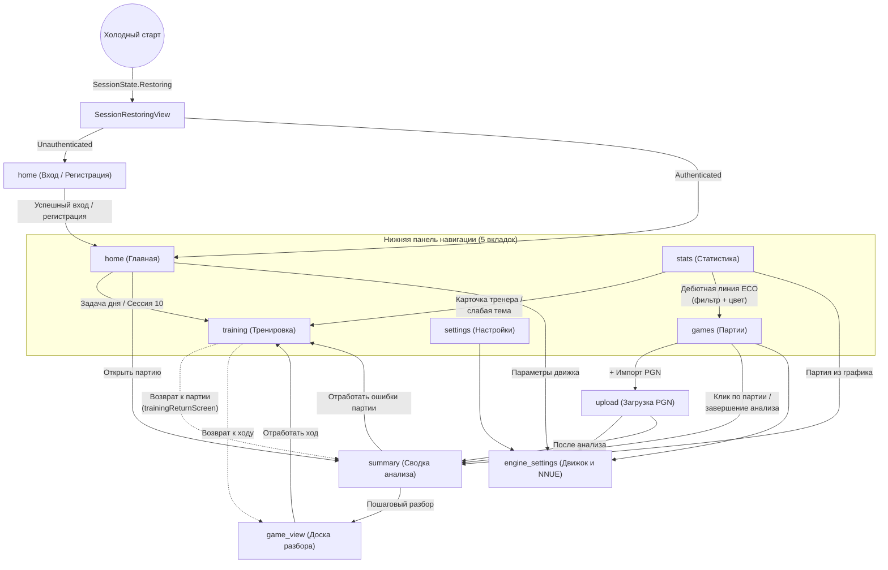

# 01. Архитектура приложения

> Навигация: [README](../README.md) · **01. Архитектура** · [02. Движок и анализ](02-engine-and-analysis.md) · [03. Тренажёр и аналитика](03-training-and-analytics.md) · [04. БД, бэкап и безопасность](04-database-backup-and-security.md) · [05. Руководство пользователя](05-user-guide.md) · [06. Сборка, CI и тесты](06-build-ci-and-testing.md)

---

## 1. Архитектурные принципы

ChessMentor — одномодульное Android-приложение (`:app`, пакет `com.example.chessmentor`) с чётким разделением на четыре слоя:

1. **Presentation (`presentation/`)** — декларативный UI на Jetpack Compose (Material 3) и пять специализированных `ViewModel`. Состояние экранов публикуется через `StateFlow` / Compose `State`, пользовательские действия уходят вверх в виде событий (паттерн **UDF — Unidirectional Data Flow**).
2. **Domain (`domain/`)** — бизнес-правила, 19 доменных сущностей, 7 контрактов репозиториев, 10 сценариев использования (`UseCase`) и самостоятельные алгоритмические подсистемы (парсер PGN, классификатор ходов, семантический анализатор, дебютная книга, планировщик SM-2, рейтинговый калькулятор, аналитика, кодек резервных копий). Подавляющее большинство доменных модулей не зависит от Android SDK и исполняется напрямую в JVM unit-тестах.
3. **Data (`data/`)** — реализация персистентности на Room SQLite v5 (5 DAO, 5 Room-репозиториев, конвертеры типов, недеструктивные миграции `1→5`, фоновое самовосстановление `DatabaseMaintenance`), два `SharedPreferences`-репозитория (сессия и параметры движка), а также Kotlin-обёртка движка (`ChessEngine`, `StockfishEngine`, `NnueDownloader`).
4. **Native (`app/src/main/cpp/`)** — изолированная C++17 обёртка `StockfishBridge`, тонкий JNI-слой `stockfish_jni.cpp` и исходники движка Stockfish `sf_19`, собираемые в `libstockfish-lib.so`.

Вспомогательный связующий пакет **`di/`** содержит потокобезопасный контейнер `AppContainer` с ленивой (`by lazy`) инициализацией зависимостей.

### Ключевые проектные решения
- **Отказ от избыточных DI-фреймворков:** граф зависимостей приложения компактен и полностью прозрачен в одном файле `AppContainer.kt` (200 строк), а тесты напрямую передают лёгкие in-memory реализации интерфейсов репозиториев и `ChessEngine` без мок-библиотек и рефлексии.
- **Единый источник истины:** долгоживущие данные хранятся в Room, настройки и сессия — в `SharedPreferences` с реактивными `StateFlow`, состояние движка и загрузки NNUE — в `ChessEngine.status: StateFlow<EngineStatus>`.
- **Строгая отменяемость (cooperative cancellation):** все длительные операции (скачивание и SHA-256 верификация NNUE, пошаговый анализ партии, поиск Stockfish, генерация задач) проверяют `coroutineContext.ensureActive()`, пробрасывают `CancellationException` и при отмене немедленно останавливают нативный поиск через `nativeStop()`.

---

## 2. Полная карта пакетов и исходных файлов

### 2.1. Точка входа и DI

| Пакет / файл | Назначение |
|---|---|
| `MainActivity.kt` | Единственная `ComponentActivity` (Single-Activity архитектура): создаёт `AppContainer`, запускает `restoreSessionIfNeeded()` и фоновую инициализацию `chessEngine.init()`, подписывает тему `ChessMentorTheme` на `sessionRepository.themeMode`, освобождает Stockfish только при окончательном закрытии (`isFinishing && !isChangingConfigurations`). |
| `di/AppContainer.kt` | Singleton-контейнер зависимостей (double-checked locking с `@Volatile`), связывающий `AppDatabase`, DAO, репозитории, `StockfishEngine`, `DatabaseMaintenance`, `SemanticMistakeAnalyzer` и все 10 Use Cases. |

### 2.2. Слой Data (`data/`) и нативный код (`cpp/`)

| Пакет | Файлы | Роль |
|---|---|---|
| `data/engine` (3) | `ChessEngine.kt`, `StockfishEngine.kt`, `NnueDownloader.kt` | Контракт движка и кодировка оценок (`MATE_VALUE = 100_000`), сериализованная `Mutex`-обёртка над JNI с отменой поиска, загрузчик и SHA-256 верификатор сети `nn-1a298aa575a0.nnue`. |
| `app/src/main/cpp` (4 + Stockfish) | `CMakeLists.txt`, `stockfish_bridge.h`, `stockfish_bridge.cpp`, `stockfish_jni.cpp`, `stockfish/src/**` | C++17 мост к `Stockfish::Engine`, потокобезопасный `stop()`, парсер UCI-оценок, JNI-экспорт и сборка `libstockfish-lib.so` (16 КБ ELF). |
| `data/local` (4) | `AppDatabase.kt`, `DatabaseMigrations.kt`, `DatabaseMaintenance.kt`, `TypeConverters.kt` | Room-база `chess_mentor_db` (версия `5`, `exportSchema = true`), идемпотентные миграции `1→5`, самовосстановление прерванных анализов и осиротевших задач, конвертеры списков и 8 перечислений. |
| `data/local/dao` (5) | `UserDao.kt`, `GameDao.kt`, `MistakeDao.kt`, `AnalyzedMoveDao.kt`, `ExerciseDao.kt` | SQL-запросы к 6 таблицам (`ExerciseDao` обслуживает и `exercises`, и `exercise_attempts`). |
| `data/repository/room` (5) | `RoomUserRepository.kt`, `RoomGameRepository.kt`, `RoomMistakeRepository.kt`, `RoomAnalyzedMoveRepository.kt`, `RoomExerciseRepository.kt` | Реализации доменных репозиториев поверх Room DAO (включая пакетную выборку ходов и ошибок по списку партий с разбиением чанками под лимит параметров SQLite). |
| `data/repository` (2) | `SharedPrefsSessionRepository.kt`, `SharedPrefsEngineSettingsRepository.kt` | Реактивное хранение активной сессии, последнего email, темы приложения, игрового ника (`user_session.xml`) и настроек движка (`engine_settings.xml`). |

### 2.3. Слой Domain (`domain/`)

| Пакет | Файлы | Роль |
|---|---|---|
| `domain/entity` (19) | `User.kt`, `Game.kt`, `AnalyzedMove.kt`, `Mistake.kt`, `Exercise.kt`, `ExerciseAttempt.kt`, `EngineSettings.kt`, `AnalysisStatus.kt`, `ChessColor.kt`, `MoveQuality.kt`, `MistakeType.kt`, `SkillLevel.kt`, `TacticalPattern.kt`, `TacticalTheme.kt`, `ExerciseSource.kt`, `KeyMoment.kt`, `ProblemTheme.kt`, `Theme.kt`, `ThemeCategory.kt` | Основные сущности предметной области (часть также аннотирована Room `@Entity`), перечисления качеств ходов, 37 тактических паттернов, уровней мастерства и тем. |
| `domain/repository` (7) | `UserRepository.kt`, `GameRepository.kt`, `MistakeRepository.kt`, `AnalyzedMoveRepository.kt`, `ExerciseRepository.kt`, `SessionRepository.kt`, `EngineSettingsRepository.kt` | Контракты доступа к данным, изолирующие Use Cases и ViewModels от Room и `SharedPreferences`. |
| `domain/usecase` (10) | `RegisterUserUseCase.kt`, `LoginUserUseCase.kt`, `ChangePasswordUseCase.kt`, `UploadGameUseCase.kt`, `AnalyzeGameUseCase.kt`, `GenerateExercisesFromMistakesUseCase.kt`, `GetTrainingExerciseUseCase.kt`, `GetUserStatisticsUseCase.kt`, `ExportUserBackupUseCase.kt`, `ImportUserBackupUseCase.kt` | Прикладные сценарии использования с типизированными `Input` и `sealed class Result`. |
| `domain/analysis` (4) | `GameMoveClassifier.kt`, `SemanticMistakeAnalyzer.kt`, `MistakeAnalysis.kt`, `GameReviewHelper.kt` | Модель `Win%`, классификация ходов, обнаружение жертв, расчёт точности и фаз партии, распознавание 13 тактических мотивов, помощник интерактивного разбора и режима исправления ошибок. |
| `domain/opening` (2) | `OpeningDatabase.kt`, `OpeningModels.kt` | Дебютная книга: 28 именованных табий ECO, 44 канонических линии, поиск теоретических ходов и перестановок, нечёткое определение дебюта по структуре доски. |
| `domain/pgn` (2) | `PgnParser.kt`, `PgnArchiveExporter.kt` | Разбиение мульти-PGN, парсинг заголовков и часов `[%clk]`, строгая валидация ходов, контроль времени, автоопределение цвета, отпечаток дедупликации и экспорт `.pgn`-архива. |
| `domain/training` (8) | `CuratedExerciseBank.kt`, `SpacedRepetitionScheduler.kt`, `TrainingRatingCalculator.kt`, `TrainingSessionPlanner.kt`, `TrainingMode.kt`, `PuzzleQualityEvaluator.kt`, `InterleavedPatternQueue.kt`, `SolutionReview.kt` | Кураторский банк (46 задач), интервальное повторение SM-2 + Лейтнер, метаданные попыток, Эло-калькулятор, планировщик «Сессии 10», оценка качества задач, чередование мотивов и разбор решения. |
| `domain/clustering` (1) | `ExerciseClusterer.kt` | Извлечение позиционных признаков, расчёт сложности `0..100` и формирование идентификатора кластера `patternClusterId`. |
| `domain/statistics` (1) | `PlayerAnalyticsCalculator.kt` | Аналитика по периодам, цветам, дебютам ECO, фазам, контролям времени, цейтноту, качеству ходов, кривой рейтинга, дневной активности и тренерским рекомендациям. |
| `domain/backup` (2) | `SimpleJson.kt`, `UserProgressBackupCodec.kt` | Безопасный RFC 8259 JSON-парсер/генератор без внешних зависимостей и кодек резервной копии `v1` с проверкой SHA-256. |
| `domain/engine` (1) | `EngineStatus.kt` | Реактивная модель `EngineStatus`, классификатор ошибок `EngineErrorReason` и чистые JVM-утилиты проверки целостности `NnueIntegrity`. |
| `domain/security` (1) | `PasswordHasher.kt` | Хеширование и проверка паролей `PBKDF2-HMAC-SHA256` + миграция устаревшего формата. |
| `domain/session` (1) | `SessionModels.kt` | `AppThemeMode` (`SYSTEM`, `LIGHT`, `DARK`) и `SessionState` (`Restoring`, `Unauthenticated`, `Authenticated`). |
| `domain/util` (1) | `ChessMoveUtils.kt` | Конвертация UCI ↔ SAN, строгая FIDE-проверка `isStrictlyLegal`, определение превращения пешки, нормализация PGN. |

### 2.4. Слой Presentation (`presentation/`)

| Пакет | Файлы | Роль |
|---|---|---|
| `presentation/viewmodel` (6) | `ChessMentorViewModelFactory.kt`, `GameViewModel.kt`, `BoardViewModel.kt`, `TrainingViewModel.kt`, `StatisticsViewModel.kt`, `SettingsViewModel.kt` | Управление состоянием экранов, корутинами (`viewModelScope`) и взаимодействием с Use Cases и движком. |
| `presentation/ui/components/navigation` (1) | `ChessMentorNavigation.kt` | Корневой `ChessMentorApp`: `Scaffold` с верхней и нижней панелями, маршрутизация между 9 экранами, стеки возврата, передача контекстных фильтров и системный `BackHandler`. |
| `presentation/ui/components/screen` (9) | `HomeScreen.kt`, `GamesListScreen.kt`, `UploadGameScreen.kt`, `SummaryScreen.kt`, `GameViewScreen.kt`, `TrainingScreen.kt`, `StatisticsScreen.kt`, `SettingsScreen.kt`, `EngineSettingsScreen.kt` | Полноэкранные Compose-экраны приложения. |
| `presentation/ui/components` (13) | `ChessBoard.kt`, `ChessBoardArrow.kt`, `ChessPieces.kt`, `EvaluationBar.kt`, `EvaluationGraph.kt`, `MiniEvaluationGraph.kt`, `HorizontalMoveList.kt`, `MoveNavigator.kt`, `MoveQualityBadge.kt`, `CompactMistakeCard.kt`, `AnalysisProgressDialog.kt`, `EngineStatusCard.kt`, `SoundManager.kt` | Переиспользуемые шахматные и аналитические виджеты + звуковой менеджер. |
| `presentation/ui/components/theme` (2) | `Color.kt`, `Theme.kt` | Цветовые палитры и тема Material 3 с поддержкой светлого, тёмного и системного режимов. |
| `presentation/ui/components/util` (1) | `ChessUtils.kt` | Вспомогательное форматирование для UI. |

---

## 3. Граф внедрения зависимостей (`AppContainer`)

### Жизненный цикл контейнера и движка
1. `AppContainer.getInstance(applicationContext)` сохраняет только `applicationContext`, исключая утечки `Activity`.
2. При первом создании `MainActivity` (`savedInstanceState == null`) запускается фоновая корутина `lifecycleScope.launch(Dispatchers.IO) { container.chessEngine.init() }` — UI отрисовывается мгновенно, не ожидая проверки или скачивания NNUE.
3. При повороте экрана или смене системной темы `isChangingConfigurations == true`, поэтому `MainActivity.onDestroy()` **не** уничтожает нативный `StockfishEngine` и не прерывает работу.
4. Только при реальном завершении активности (`isFinishing && !isChangingConfigurations`) вызывается `container.cleanup()` → `chessEngine.destroy()`, который атомарно останавливает активный поиск и освобождает память C++.

---

## 4. Справочник репозиториев (`domain/repository`)

| Интерфейс | Реализация | Ключевые операции |
|---|---|---|
| `UserRepository` | `RoomUserRepository` | Поиск по `id`, `email`, `nickname`; регистрация, обновление профиля/рейтинга/настроек, каскадное удаление пользователя. |
| `GameRepository` | `RoomGameRepository` | CRUD партий пользователя, обновление статуса и результатов анализа (`accuracy`, `averageEvaluationLoss`, счётчики ошибок, `evaluationsJson`), удаление с каскадной очисткой ходов и ошибок. |
| `AnalyzedMoveRepository` | `RoomAnalyzedMoveRepository` | Сохранение и замена пошагового анализа партии (`AnalyzedMove`), выборка по `gameId` и пакетная выборка по списку `gameIds` (для статистики и бэкапа). |
| `MistakeRepository` | `RoomMistakeRepository` | Сохранение и выборка ошибок игрока по партии, списку партий и `userId`, агрегация по темам и типам ошибок. |
| `ExerciseRepository` | `RoomExerciseRepository` | Хранение глобальных кураторских (`sourceGameId == null`) и персональных задач, выборка доступных задач с изоляцией по `userId`, обновление счётчиков решаемости, запись и чтение `ExerciseAttempt`. |
| `SessionRepository` | `SharedPrefsSessionRepository` | Реактивные `activeUserId`, `lastLoginEmail`, `themeMode: StateFlow<AppThemeMode>`, персональная подсказка игрового ника (`getChessUsernameHint` / `setChessUsernameHint`), очистка сессии и данных удалённого аккаунта. |
| `EngineSettingsRepository` | `SharedPrefsEngineSettingsRepository` | Чтение, валидация, сохранение и сброс `EngineSettings` (`depth`, `threads`, `hashSizeMb`). |

---

## 5. Справочник сценариев использования (`domain/usecase`)

| Use Case | Вход | Выход | Основные гарантии |
|---|---|---|---|
| `RegisterUserUseCase` | `nickname`, `email`, `password`, `rating` | `Success(User)` / `Error` | Проверка длины ника (`3..50`), формата email, пароля (`≥ 6`), рейтинга (`0..3500`), уникальности email и ника; хеширование через `PasswordHasher.hash`; расчёт `SkillLevel`. |
| `LoginUserUseCase` | `email`, `password` | `Success(User)` / `Error` | Проверка `PBKDF2-HMAC-SHA256`; прозрачная миграция старых `hashed_*` записей в PBKDF2 при успешном входе; обновление `lastLogin`. |
| `ChangePasswordUseCase` | `userId`, `currentPassword`, `newPassword`, `confirmPassword` | `Success(User)` / `Error` | Проверка текущего пароля, длины нового (`6..128`), совпадения подтверждения и отличия от старого; перезапись PBKDF2-хеша с новой солью. |
| `UploadGameUseCase` | `userId`, `pgnData`, `playerColor`, `timeControl`, `playedAt`, `allowDuplicate` | `Success(Game)` / `Duplicate` / `Error` | Валидация и обогащение PGN через `PgnParser`, проверка дубликатов по отпечатку ходов и заголовков, сохранение со статусом `PENDING`. |
| `AnalyzeGameUseCase` | `gameId`, `forceReanalyze` | `Flow<AnalysisProgress>` (`Starting` → `InProgress` → `Completed` / `Failed`) | Защита от параллельного анализа одной и той же партии (`activeGameIds`), конвейерный разбор Stockfish обеих сторон, запись `AnalyzedMove`, `Mistake` и `evaluationsJson`, корректный откат статуса в `PENDING` при отмене (`NonCancellable`). |
| `GenerateExercisesFromMistakesUseCase` | `userId`, `maxExercises = 50` | `Success(count, exercises)` / `Error` | Отсев неподходящих позиций (`PuzzleQualityEvaluator`), проверка единственности решения на Stockfish, обрезка PV в «тихой» точке нечётной длины, сохранение `PREV_MOVE`/`PRE_FEN`/`GOAL`, кластеризация и изоляция дублей по `userId`. |
| `GetTrainingExerciseUseCase` | `userId`, `mode`, `sessionPhase`, `preferredPattern`, `avoidPattern`, `excludeExerciseIds`, `epochDay`, `nowMs` | `Success(exercise, reviewState, dueReviewCount, completedRatedSittings, ...)` / `Error` | Автозасев `CuratedExerciseBank`, построение расписания SM-2, подбор в зоне ближайшего развития (`±18` пунктов сложности), приоритет просроченных повторений и защита от повтора одного паттерна подряд. |
| `GetUserStatisticsUseCase` | `userId`, `period = StatsPeriod.ALL`, `nowMs` | `UserStatistics` | Объединение партий, пакетно загруженных `AnalyzedMove`/`Mistake`, полного расписания SM-2, кривой Эло, 14-дневной активности, репертуара ECO, диагностики цейтнота и тренерских карточек действий. |
| `ExportUserBackupUseCase` | `userId`, `nowMs`, `zoneId` | `Success(jsonContent, suggestedFileName, summary)` / `Error` | Сборка полного снимка профиля, настроек, партий, ходов, ошибок, персональных задач и попыток (кураторских по `CURATED_ID` и персональных по индексу), подпись `SHA-256`, без `passwordHash`. |
| `ImportUserBackupUseCase` | `userId`, `rawJson`, `restorePreferences = true` | `Success(ImportSummary)` / `Error` | Проверка схемы и `SHA-256`, идемпотентное слияние партий по отпечатку PGN, апгрейд `PENDING → COMPLETED`, перепривязка `sourceGameId` и `exerciseId`, дедупликация попыток и пересчёт счётчиков задач. |

---

## 6. ViewModels и управление состоянием UI

| ViewModel | Область жизни | Зона ответственности |
|---|---|---|
| `GameViewModel` | `MainActivity` (общая на сессию) | Восстановление/завершение сессии (`sessionState`), текущий `User`, библиотека `userGames`, выбранная партия (`selectedGame`, `selectedGameMistakes`, `selectedGameAnalyzedMoves`), загрузка мульти-PGN, запуск и отмена анализа партии с прогрессом и автогенерацией задач. |
| `BoardViewModel` | `ChessMentorApp` (общая для разбора) | Состояние доски `Board`, текущий полуход `currentMoveIndex`, переворот доски, пошаговая навигация и прыжки по ключевым моментам, часы сторон, живая линия Stockfish (`liveEngineLine`), режим исправления ошибки (`retryState`) и дерево свободного исследовательского варианта (`variationSteps`). |
| `TrainingViewModel` | Экран `TrainingScreen` | Выбор `TrainingMode`, управление «Сессией 10» и `InterleavedPatternQueue`, обработка ходов игрока и автоответов соперника, превращение пешки, проверка альтернативных выигрышей на Stockfish, подсказки (`HintUsage`), таймер первого хода и импульсивности, обновление Эло, запись `ExerciseAttempt` и интерактивный разбор решения. |
| `StatisticsViewModel` | Экран `StatisticsScreen` | Загрузка и кэширование `UserStatistics`, переключение периода (`7 дней` / `30 дней` / `Всё время`) и вкладок отчёта, обновление при изменении данных. |
| `SettingsViewModel` | Экран `SettingsScreen` | Редактирование никнейма, смена пароля, переключение темы приложения, темы доски и звука, сохранение игрового ника, управление файлом NNUE (проверка SHA-256 / повторная загрузка), экспорт `.pgn`, экспорт и восстановление полного `.json`-бэкапа, удаление аккаунта. |

---

## 7. Навигационный граф

Навигация реализована в [`ChessMentorNavigation.kt`](../app/src/main/java/com/example/chessmentor/presentation/ui/components/navigation/ChessMentorNavigation.kt) на сохраняемом состоянии `rememberSaveable` (переживает поворот экрана и пересоздание процесса) с явными стеками возврата (`summaryReturnScreen`, `trainingReturnScreen`, `engineSettingsReturnScreen`) и перехватом системного жеста/кнопки «Назад» (`BackHandler`).

### Контекстные переходы между экранами
- **Из сводки или доски разбора → в тренажёр:** передаётся режим `TrainingMode.FromGame(gameId, focusMoveNumber)` (`routeKey = "game_<id>"` или `"game_<id>_move_<n>"`), а кнопка «Назад» возвращает пользователя точно на тот экран (`summary` или `game_view`), откуда была запущена отработка.
- **Из статистики → в библиотеку партий:** клик по строке дебютного репертуара открывает `games` с предзаполненным поисковым запросом (название/ECO дебюта) и фильтром цвета (`pendingGamesSearchQuery`, `pendingGamesColorKey`).
- **Из статистики → в тренажёр:** карточки тренерского плана и проблемных тем запускают целевой `TrainingMode` (`WeakPatterns`, `Defense`, `DeepCalculation`, `SmartSession`, `ByTheme(...)` и др.).
- **Полноэкранный фокус на доске:** на экранах `game_view` и `engine_settings` нижняя панель `NavigationBar` скрывается, освобождая вертикальное пространство для шахматной доски и тренерской панели.

---

## 8. Модель многопоточности и потокобезопасность

| Операция | Диспетчер | Механизм синхронизации и отмены |
|---|---|---|
| Отрисовка Compose, обновление `StateFlow` | `Dispatchers.Main` | Однопоточный UI-контекст; тяжёлые вычисления на главном потоке отсутствуют. |
| Запросы Room, чтение/запись SAF (`.pgn`, `.json`), загрузка и SHA-256 проверка NNUE | `Dispatchers.IO` | Транзакции Room, атомарный перенос `.part` → целевой файл, проверка `ensureActive()` на каждом 64-КБ блоке. |
| Поиск Stockfish (`evaluate`, `getBestMove`, `getBestMoveWithLine`) | `Dispatchers.Default` | Kotlin `Mutex` в `StockfishEngine` + `opMutex_` / `stopMutex_` / `atomic<bool> stopRequested_` в C++ `StockfishBridge`; дочерний `Job(parent = coroutineContext[Job])` вызывает `nativeStop()` мгновенно при отмене корутины. |
| Пошаговый анализ партии (`AnalyzeGameUseCase`) | `Dispatchers.IO` + `Default` | `Collections.synchronizedSet(activeGameIds)` защищает от двойного запуска; блок `finally` с `withContext(NonCancellable)` гарантирует консистентный откат статуса в БД при отмене. |
| Живой анализ на доске разбора (`BoardViewModel`) | `viewModelScope` | Предыдущий `Job` живой оценки отменяется при каждом переходе на новый полуход; при активном фоновом анализе партии живой движок аккуратно уступает ресурс (`isEngineBusy`). |
