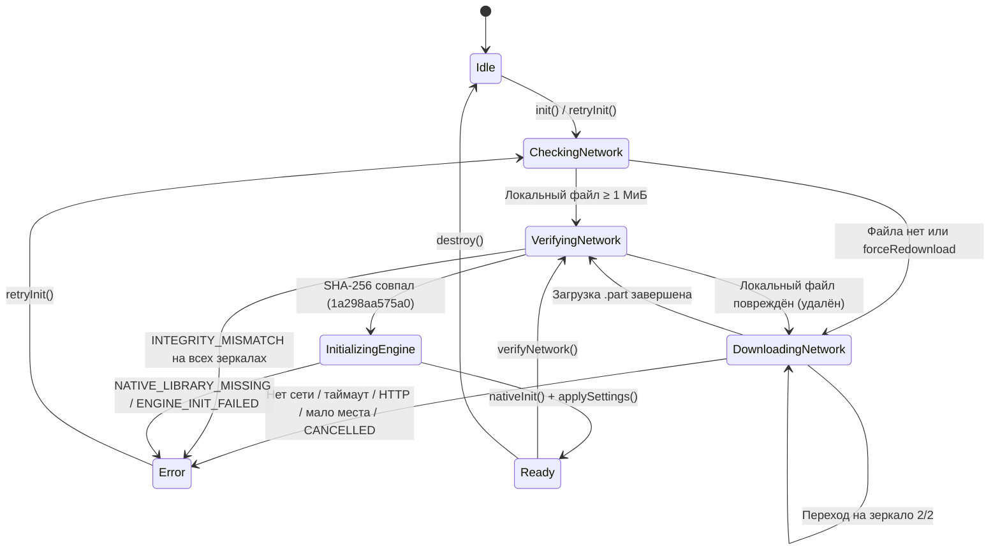

# 02. Движок Stockfish 19 и алгоритмы анализа партий

> Навигация: [README](../README.md) · [01. Архитектура](01-architecture.md) · **02. Движок и анализ** · [03. Тренажёр и аналитика](03-training-and-analytics.md) · [04. БД, бэкап и безопасность](04-database-backup-and-security.md) · [05. Руководство пользователя](05-user-guide.md) · [06. Сборка, CI и тесты](06-build-ci-and-testing.md)

---

## 1. Нативный слой Stockfish 19 (C++17 + JNI)

Вместо запуска отдельного консольного бинарника и парсинга stdout по пайпам ChessMentor линкует исходники **Stockfish `sf_19`** напрямую в разделяемую библиотеку `libstockfish-lib.so` и работает с объектом `Stockfish::Engine` через типизированные коллбэки.

### 1.1. Параметры компиляции (`app/src/main/cpp/CMakeLists.txt`)
- **Стандарт и оптимизация:** C++17 (`CMAKE_CXX_STANDARD 17`), `-O3 -fno-exceptions -Wall -Wcast-qual`.
- **Общие макросы:** `NDEBUG`, `IS_64BIT`, `USE_POPCNT`, `USE_PREFETCH`, `NNUE_EMBEDDING_OFF` (файл нейросети не раздувает APK, а загружается в `filesDir/nnue/`).
- **Архитектурные SIMD-расширения:**
  - `arm64-v8a` — `USE_NEON=8` (соответствует профилю `ARCH=armv8` в Makefile Stockfish);
  - `x86_64` — `USE_SSE2`, `USE_SSSE3`, `USE_SSE41` и флаги `-msse4.1 -mpopcnt`.
- **Android 15+ (16 КБ страницы памяти):** флаг линковщика `-Wl,-z,max-page-size=16384` (автоматически проверяется в CI через `llvm-readelf -l`).

### 1.2. Архитектура `StockfishBridge` и JNI-контракт

Вся логика управления движком изолирована в `chessmentor::StockfishBridge` ([`stockfish_bridge.h`](../app/src/main/cpp/stockfish_bridge.h), [`stockfish_bridge.cpp`](../app/src/main/cpp/stockfish_bridge.cpp)), а [`stockfish_jni.cpp`](../app/src/main/cpp/stockfish_jni.cpp) отвечает исключительно за маршалинг строк `JNIEnv` и логирование в Android Logcat (`StockfishJni`).

| JNI-метод (`StockfishEngine`) | C++ вызов | Назначение и формат возврата |
|---|---|---|
| `nativeInit(netPath: String): Boolean` | `bridge().init(path)` | Проверяет размер файла сети (`≥ 1 МиБ`), однократно инициализирует таблицы `Attacks::init()` и `Position::init()` (`std::call_once`), создаёт `Stockfish::Engine`, подписывает коллбэки `on_update_full`, `on_update_no_moves`, `on_bestmove` и загружает сеть через UCI-опцию `EvalFile`. |
| `nativeSetOption(name: String, value: String)` | `bridge().setOption(...)` | Дожидается завершения активного поиска и применяет UCI-параметр (`Threads`, `Hash`, `Clear Hash`). |
| `nativeEvaluate(fen: String, depth: Int): Int` | `bridge().evaluate(...)` | Возвращает оценку позиции с точки зрения **ходящей стороны** (диапазон глубины `1..64`). |
| `nativeGetBestMove(fen: String, depth: Int): String?` | `bridge().bestMove(...)` | Возвращает сильнейший ход в формате UCI (`"e2e4"`, `"e7e8q"`) или `null` в терминальной позиции (`"(none)"`). |
| `nativeGetBestMoveWithLine(fen: String, depth: Int): String?` | `bridge().bestLine(...)` | Возвращает строку `"<bestMove>\t<score>\t<pv>"` (в позиции мата/пата `bestMove` и `pv` пусты, `score` корректен). |
| `nativeStop()` | `bridge().stop()` | Неблокирующая остановка поиска из любого потока (через отдельный `stopMutex_` и `std::atomic<bool> stopRequested_`). |
| `nativeDestroy()` | `bridge().destroy()` | Вызывает `stop()`, обнуляет `activeEngine_` и уничтожает `std::unique_ptr<Stockfish::Engine>`. |

### 1.3. Кодировка оценок и матов

В C++ (`StockfishBridge::parseScore`) и Kotlin (`ChessEngine.Companion`) действует единая шкала оценок:

| Константа / ситуация | Значение / формула | Пример отображения |
|---|---|---|
| `MATE_VALUE` | `100_000` | — |
| `MATE_THRESHOLD` | `90_000` (`abs(score) >= 90_000` — мат) | — |
| Обычная оценка `cp V` | `clamp(V, -89_900, +89_900)` сантипешек | `+135` → `"+1.4"`, `-80` → `"-0.8"` |
| Мат за ходящего в `N` ходов (`mate +N`) | `100_000 - min(N, 100) * 100` | `N = 3` → `99_700` → `"+M3"` |
| Мат против ходящего в `N` ходов (`mate -N`) | `-(100_000 - min(N, 100) * 100)` | `N = 2` → `-99_800` → `"-M2"` |
| Сторона уже получила мат (`mate 0`) | `-100_000` | `"-M"` |

> **Соглашение о перспективе:** `ChessEngine` возвращает оценки со стороны **ходящего** (как в протоколе UCI). При сохранении в `AnalyzedMove` и `Game.evaluationsJson` все оценки приводятся к **перспективе белых** (`+` в пользу белых, `−` в пользу чёрных), а `GameMoveClassifier` переводит их в перспективу автора хода при расчёте `Win%`.

### 1.4. Отмена поиска из Kotlin Coroutines

В [`StockfishEngine.runCancellableSearch`](../app/src/main/java/com/example/chessmentor/data/engine/StockfishEngine.kt) перед блокирующим JNI-вызовом создаётся легковесный дочерний `val cancelWatcher = Job(parent = coroutineContext[Job])` с обработчиком `invokeOnCompletion`. Если вызывающая корутина отменяется во время глубокого расчёта C++, родительский `Job` синхронно отменяет `cancelWatcher`, тот мгновенно вызывает `nativeStop()`, Stockfish прерывает перебор, а в блоке `finally` обработчик освобождается без утечек памяти.

---

## 2. Загрузка, проверка SHA-256 и жизненный цикл NNUE

Модули: [`NnueDownloader.kt`](../app/src/main/java/com/example/chessmentor/data/engine/NnueDownloader.kt), [`EngineStatus.kt`](../app/src/main/java/com/example/chessmentor/domain/engine/EngineStatus.kt).

- **Файл сети по умолчанию:** `nn-1a298aa575a0.nnue` (каталог `context.filesDir/nnue/`).
- **Ожидаемый префикс SHA-256:** `1a298aa575a0` (первые 12 hex-символов хеша, совпадающие с правилом Stockfish `evaluate.h`).
- **Официальные зеркала (по порядку обхода):**
  1. `https://tests.stockfishchess.org/api/nn/nn-1a298aa575a0.nnue`
  2. `https://github.com/official-stockfish/networks/raw/master/nn-1a298aa575a0.nnue`
- **Параметры надёжности:**
  - таймаут соединения `15 с`, чтения `60 с`, буфер `64 КБ`, публикация прогресса каждые `120 мс`;
  - предварительная проверка свободного места: `Content-Length + 16 МиБ` (или `96 МиБ`, если сервер не прислал размер);
  - запись строго во временный файл `nn-1a298aa575a0.nnue.part`; только после успешной потоковой проверки `SHA-256` файл атомарно переименовывается в целевое имя — битая сеть никогда не попадёт в нативный Stockfish (где ошибка загрузки сети завершила бы процесс).

### Профили настроек движка (`EngineSettings`)

| Параметр | Минимум | По умолчанию | Максимум | Профиль «Быстрый» | Профиль «Глубокий» |
|---|---|---|---|---|---|
| Глубина (`depth`, полуходы) | `10` | `15` | `25` | `12` | `22` |
| Потоки CPU (`threads`) | `1` | `2` | `8` | `1` | `4` |
| Хеш-таблица (`hashSizeMb`, МБ) | `16` | `32` | `256` | `16` | `128` |

---

## 3. Конвейер импорта и валидации PGN

Модули: [`PgnParser.kt`](../app/src/main/java/com/example/chessmentor/domain/pgn/PgnParser.kt), [`ChessMoveUtils.kt`](../app/src/main/java/com/example/chessmentor/domain/util/ChessMoveUtils.kt), [`UploadGameUseCase.kt`](../app/src/main/java/com/example/chessmentor/domain/usecase/UploadGameUseCase.kt), [`PgnArchiveExporter.kt`](../app/src/main/java/com/example/chessmentor/domain/pgn/PgnArchiveExporter.kt).

1. **Разделение мульти-PGN (`PgnParser.splitGames`):** корректно режет архивы из десятков/сотен партий по границам секций тегов `[Event ...]`, не ломаясь на скобках внутри фигурных комментариев `{...}` и строковых значений `"..."`.
2. **Извлечение метаданных и часов:** читаются стандартные и расширенные теги (`Event`, `Site`, `Date`/`UTCDate`, `White`, `Black`, `WhiteElo`, `BlackElo`, `WhiteTitle`, `BlackTitle`, `Result`, `ECO`, `Opening`, `TimeControl`, `Termination`, `Variant`, `FEN`, `SetUp`) и аннотации времени `[%clk H:MM:SS(.s)]` по каждому полуходу. Экзотические варианты (`Atomic`, `Crazyhouse`, `Horde`, `Three-check`, `King of the Hill`, `Antichess`, `Racing Kings`) явно отклоняются с понятным сообщением.
3. **Нормализация текста ходов (`ChessMoveUtils.normalizePgn`):** снимается UTF-8 BOM, удаляются строчные комментарии `;...`, фигурные комментарии `{...}`, произвольно вложенные скобки вариантов `(... (...))`, числовые NAG (`$1`, `$2`...) и суффиксы `!?`; заменяются нулевые рокировки `0-0`/`0-0-0` → `O-O`/`O-O-O` и фигурные Unicode-символы `♔♕♖♗♘` → `KQRBN`.
4. **Строгая FIDE-валидация (`ChessMoveUtils.isStrictlyLegal`):** каждый полуход проигрывается на доске с проверкой принадлежности множеству `board.legalMoves()` (включая геометрию фигур, блокировки, рокировку через битое поле, взятие на проходе и превращение), а не только отсутствия шаха своему королю.
5. **Контроль времени и классификация по Lichess:** поддерживаются секунды PGN (`180+2`, `600`, `5400+30`), ручной ввод в минутах (`3+2`, `10+0`, `90+30`), турнирные фазы (`40/5400+30`) и заочные партии (`1/86400`). Категория вычисляется по формуле `estimated = baseSeconds + 40 × incSeconds`:
   - `< 180 с` — **Пуля** (`BULLET`);
   - `180..479 с` — **Блиц** (`BLITZ`);
   - `480..1499 с` — **Рапид** (`RAPID`);
   - `≥ 1500 с` — **Классика** (`CLASSICAL`).
   При экспорте в `.pgn` метод `PgnParser.toCanonicalPgnTimeControl` приводит минутные записи к стандарту FIDE PGN в секундах (`"3+2"` → `"180+2"`).
6. **Автоопределение цвета и дедупликация:** `detectPlayerColor` сопоставляет `White`/`Black` с никнеймом профиля, сохранённым игровым ником Lichess/Chess.com и локальной частью email; отпечаток `fingerprint` предотвращает случайную повторную загрузку одной и той же партии.

---

## 4. Математическая модель анализа партий (`GameMoveClassifier`)

Модуль: [`GameMoveClassifier.kt`](../app/src/main/java/com/example/chessmentor/domain/analysis/GameMoveClassifier.kt), оркестрация — [`AnalyzeGameUseCase.kt`](../app/src/main/java/com/example/chessmentor/domain/usecase/AnalyzeGameUseCase.kt).

### 4.1. Вероятность победы `Win%`

Оценка позиции `cp` (с точки зрения ходящей стороны, ограниченная диапазоном `[-1000, +1000]`) переводится в ожидаемую вероятность победы `Win% ∈ [0, 100]` по логистической кривой Lichess (калибровка по партиям Stockfish NNUE):

$$\text{Win\%}(cp) = 50 + 50 \cdot \left(\frac{2}{1 + e^{-0.00368208 \cdot cp}} - 1\right)$$

Для форсированного мата за ходящего `Win% = 100`, против ходящего — `Win% = 0`. Потеря качества хода измеряется в процентных пунктах:

$$\Delta\text{Win\%} = \max\bigl(0,\ \text{Win\%}(\text{eval}_{\text{before}}) - \text{Win\%}(\text{eval}_{\text{after}})\bigr)$$

Благодаря нелинейности сигмоиды переход `+8.0 → +5.0` (упрощение в абсолютно выигранной позиции) почти не снижает `Win%` и не считается зевком, тогда как промах `+0.2 → -2.1` в равной борьбе обрушивает `Win%` более чем на 35 п.п. и справедливо классифицируется как `BLUNDER`.

### 4.2. Десять категорий качества хода (`MoveQuality`)

| Категория | Значок / цвет | Условие присвоения |
|---|---|---|
| `BOOK` — Теория | 📖 `#CE93D8` | Непрерывная теоретическая цепочка до 15-го хода (или точная перестановка до 12-го хода) в дереве `OpeningDatabase` без существенной потери `Win%`. |
| `BRILLIANT` — Блестящий ход | 💎 `#26C6DA` | Обнаружена реальная жертва материала (`netOfferedCp ≥ 180`, фигуру легально и выгодно бить — прямая жертва `DIRECT_PIECE` или оставление под боем `INDIRECT_HANGING`), позиция до хода не была разгромной (`< +500 сП`) и не безнадёжной (`> -600 сП`), ход сохраняет/даёт перевес при минимальной потере `Win%`. |
| `GREAT_MOVE` — Отличный ход | 👍 `#66BB6A` | Сильный ход с одной из трёх причин `GreatMoveReason`: (1) `PUNISHED_OPPONENT_MISTAKE` — точное наказание ошибки соперника (не банальное обратное взятие на том же поле); (2) `FOUND_FORCED_MATE` — найден неочевидный форсированный мат из борьбы; (3) `CRITICAL_DEFENSE` — единственная точная защита под шахом или в острой позиции. |
| `BEST_MOVE` — Лучший ход | ⭐ `#9CCC65` | Совпадение с первой линией Stockfish или потеря `ΔWin% ≤ 0.5` п.п. |
| `EXCELLENT` — Превосходный | ✅ `#81C784` | Потеря `0.5 < ΔWin% ≤ 2.0` п.п. |
| `GOOD` — Хороший ход | ✓ `#A5D6A7` | Потеря `2.0 < ΔWin% ≤ 5.5` п.п. (а также удлинение/укорочение уже существовавшего неизбежного мата без смены победителя). |
| `INACCURACY` — Неточность | ⚡ `#FFCA28` | Потеря `5.5 < ΔWin% ≤ 10.5` п.п. (либо упущен форсированный мат с сохранением подавляющего перевеса `≥ +450 сП`). |
| `MISTAKE` — Ошибка | ⚠️ `#FF7043` | Потеря `10.5 < ΔWin% ≤ 20.0` п.п. |
| `MISSED_WIN` — Упущенная победа | 💔 `#E91E63` | Выпуск форсированного мата или решающего перевеса в равную/неясную позицию (без немедленного проигрыша партии). |
| `BLUNDER` — Зевок | ❌ `#EF5350` | Потеря `ΔWin% > 20.0` п.п. или зевок форсированного мата из не проигранной позиции. |

### 4.3. Точность хода, партии и фаз

Точность отдельного хода `acc_i ∈ [0, 100]` (для `BOOK` и ходов с `WinAfter ≥ WinBefore` равна `100%`):

$$\text{acc}_i = \operatorname{clamp}_{[0, 100]}\!\left(103.1668 \cdot e^{-0.04354 \cdot \Delta\text{Win\%}_i} - 3.1669\right)$$

Итоговая точность стороны в партии (`calculateGameAccuracy`) вычисляется по методике Lichess:
1. Последовательность ходов стороны разбивается скользящим окном размера `w = clamp(n / 10, 2, 8)`.
2. Для каждого окна считается стандартное отклонение `Win%` (волатильность позиции) — острые критические отрезки получают больший вес, чем спокойное маневрирование.
3. Вычисляются **взвешенное по волатильности среднее** и **гармоническое среднее** (сильнее штрафующее грубые провалы), и берётся их среднее арифметическое с округлением до `0.1%`.
4. **ACPL** (`calculateAverageCentipawnLoss`) считается по ограниченным потерям сантипешек (`EVAL_CAP_CP = 1000`), чтобы один матовый код `100_000` не искажал среднее по всей партии.

### 4.4. Монотонное разбиение на фазы (`detectGamePhases`)

Каждому полуходу сопоставляется фаза `OPENING → MIDDLEGAME → ENDGAME` (переход строго монотонный, без отката назад):
- переход в **`MIDDLEGAME`** происходит после выхода из дебютной книги, когда `moveNumber > 14`, либо `moveNumber > 6` и на последней горизонтали осталось `≤ 1` неразвитой лёгкой фигуры, либо `moveNumber > 4` и на доске осталось `≤ 10` тяжёлых/лёгких фигур, либо произошло смешение фигур на крайних горизонталях;
- переход в **`ENDGAME`** фиксируется при снижении суммарного фигурного материала до эндшпильного порога (`isEndgameMaterial`; отдельно распознаётся чисто пешечный эндшпиль `isPurePawnEndgame`).

---

## 5. Дебютная книга (`OpeningDatabase`) и семантический анализ ошибок

### 5.1. Дерево дебютной теории (`domain/opening/OpeningDatabase.kt`)
- Содержит **28** структурированных дебютных табий `OpeningPosition` (ECO-код, русское и английское названия, каноническая последовательность SAN, характеристики стиля `OpeningCharacteristic` и ключевые стратегические идеи) и **44** расширенных главных варианта `CanonicalBookLine` (открытые, полуоткрытые, закрытые, индийские и фланговые дебюты глубиной до 10–14 полуходов).
- При инициализации каждая линия строго проигрывается через `MoveList(board.fen)` с проверкой `board.legalMoves()`, формируя три быстрых индекса по ключу `"<boardFen> <activeSide>"`: `exactBookOpenings`, `canonicalLineOpenings` и `bookPrefixPositions`.
- Благодаря ключу по позиции и очереди хода автоматически распознаются **перестановки ходов** (например, `1. Nf3 Nc6 2. e4 e5 3. Bc4` → `C50 Итальянская партия`), а сомнительные ранние выпады (например, `1. e4 e5 2. Qh5`) отсекаются и не получают метку `BOOK`.
- Для общей идентификации дебюта партии (`findOpening`) дополнительно поддерживается структурное сопоставление 64 клеток доски с проверкой всех ключевых отличий шаблона от начальной позиции.

### 5.2. Семантический разбор ошибок (`SemanticMistakeAnalyzer`) и интерактивный ревью

[`SemanticMistakeAnalyzer`](../app/src/main/java/com/example/chessmentor/domain/analysis/SemanticMistakeAnalyzer.kt) и [`MistakeAnalysis.kt`](../app/src/main/java/com/example/chessmentor/domain/analysis/MistakeAnalysis.kt) дополняют числовую оценку Stockfish содержательным объяснением:
- **Категория ошибки (`MistakeCategory`, 5 типов):** угроза мата (`MATE_THREAT`), потеря материала (`MATERIAL_BLUNDER`), упущенная тактика (`MISSED_TACTIC`), безопасность короля (`KING_SAFETY`), позиционная уступка (`POSITIONAL`).
- **13 распознаваемых тактических мотивов (`TacticalMotif`):** вилка (`FORK`), связка (`PIN`), сквозной удар (`SKEWER`), вскрытое нападение (`DISCOVERED_ATTACK`), вскрытый шах (`DISCOVERED_CHECK`), мат по последней горизонтали (`BACK_RANK`), спёртый мат (`SMOTHERED_MATE`), перегрузка (`OVERLOADING`), устранение защитника (`REMOVING_DEFENDER`), отвлечение (`DEFLECTION`), ловля фигуры (`TRAPPED_PIECE`), ловля ферзя (`QUEEN_TRAP`) и незащищённая фигура (`HANGING_PIECE`).
- **Интерактивное исправление ошибок (`GameReviewHelper`):** на экране разбора игрок может скрыть подсказку и сам найти сильнейший ход с доски. `GameReviewHelper` сверяет ход с `bestMove`, а для альтернативных легальных кандидатов запрашивает Stockfish и засчитывает ход, если он сохраняет близкую к оптимальной оценку.
