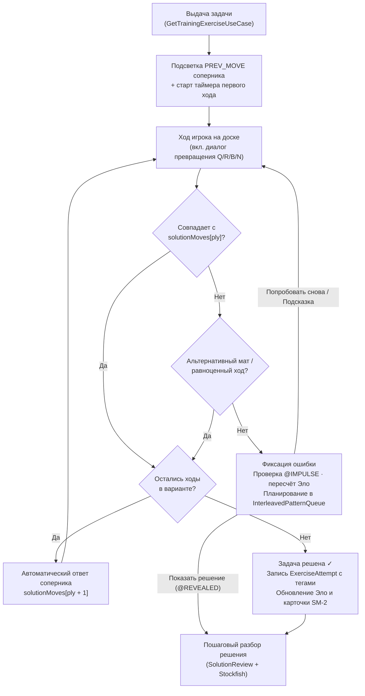

# 03. Адаптивный тренажёр, интервальное повторение SM-2 и аналитика

> Навигация: [README](../README.md) · [01. Архитектура](01-architecture.md) · [02. Движок и анализ](02-engine-and-analysis.md) · **03. Тренажёр и аналитика** · [04. БД, бэкап и безопасность](04-database-backup-and-security.md) · [05. Руководство пользователя](05-user-guide.md) · [06. Сборка, CI и тесты](06-build-ci-and-testing.md)

---

## 1. Источники упражнений и контроль качества задач

В ChessMentor объединены два взаимодополняющих пула задач, хранящихся в таблице `exercises`:

1. **Встроенный кураторский банк (`CuratedExerciseBank`)** — **46** вручную проверенных позиций (`sourceGameId = null`, `createdFrom = IMPORTED`) с уникальными тегами `CURATED_ID:<id>` и названиями `TITLE:<название>`. Охватывает все базовые и продвинутые мотивы за белых и чёрных (вилки, связки, сквозные удары, вскрытые и двойные шахи, маты по 8-й горизонтали, спёртый, арабский и мат Бодена, отвлечение, завлечение, устранение защитника, жертвы, ловля фигур, единственная защита, пешечные прорывы и слабое превращение в коня). Банк автоматически и идемпотентно засевается при первом обращении и доступен сразу после регистрации — даже без загруженных партий и без интернета.
2. **Персональные задачи из ошибок игрока (`GenerateExercisesFromMistakesUseCase`)** — привязаны к конкретной партии и ходу (`sourceGameId`, `sourceMoveNumber`, `createdFrom = MISTAKE`) и строго изолированы по `userId`.

### 1.1. Фильтр учебной ценности (`PuzzleQualityEvaluator`)

Далеко не каждая ошибка в партии образует хорошую тактическую задачу. Перед сохранением позиция проходит многоступенчатый отбор:
- **Отсев безнадёжных позиций:** если до хода оценка уже `≤ -550 сП` (`HOPELESS_EVAL_THRESHOLD_CP`), задача отклоняется.
- **Отсев технических неточностей в выигранных позициях:** при оценке `≥ +700 сП` (`ALREADY_CRUSHING_EVAL_CP`) допускаются только грубые срывы с потерей `≥ 400 сП`.
- **Минимальный порог самостоятельной ценности:** потеря не менее `110 сП` (`MIN_STANDALONE_LOSS_CP`) либо явный тактический мотив / единственное спасение (для защитных задач сохраняется тег `GOAL:DEFENSE`).
- **Проверка чёткости и единственности решения (`hasClearTacticalSolution`):** Stockfish проверяет, что лучший ход существенно превосходит альтернативы (`MIN_UNIQUENESS_GAP_CP = 75 сП`, глубина проверки `8`, глубина основной линии `12`).
- **Обрезка главной линии в «тихой» точке (`trimPvAtQuiescence`):** вариант обрезается до нечётного числа полуходов (не более `MAX_QUIESCENCE_PLIES = 7`), чтобы завершаться ходом игрока после окончания форсированных взятий и шахов, не обрываясь посреди незавершённого размена.
- **Контекст партии (`ExerciseMetadata`):** в `patternFeatures` записываются `PRE_FEN:<fen>` и `PREV_MOVE:<uci>`, что позволяет тренажёру показать на доске последний ход соперника, создавший тактический шанс или угрозу.

### 1.2. Кластеризация и сложность (`ExerciseClusterer`, `TacticalPattern`)

Каждой задаче присваиваются:
- один из **37** детальных паттернов `TacticalPattern` (5 видов вилок, абсолютная и относительная связки, сквозной удар, вскрытое нападение/шах, двойной шах, 5 матовых конструкций, устранение защитника, отвлечение, завлечение, перегрузка, ловля фигуры/ферзя, незащищённая фигура, цугцванг, пат, вечный шах, слабое поле, прорыв пешки, жертва качества/фигуры, защита, контратака, блокада, позиционный ход, техника эндшпиля, расчёт, комбинированная тактика);
- укрупнённая тема `TacticalTheme` (`FORK`, `PIN`, `DISCOVERED_ATTACK`, `MATE`, `MATERIAL_LOSS`, `KING_SAFETY`, `TACTIC`, `UNKNOWN`);
- численная сложность `difficultyRating ∈ [0, 100]` и ориентировочный рейтинг Эло `rating = 800 + difficultyRating × 16` (`800..2400`);
- идентификатор кластера `patternClusterId` (сочетание мотива, подтипа и уровня сложности) с индексом в БД.

---

## 2. Режимы тренировки и структурированная «Сессия 10»

### 2.1. Все 10 режимов (`TrainingMode`)

| Режим | `routeKey` | Название в UI | Назначение |
|---|---|---|---|
| `All` | `all` | Все задачи | Адаптивный поток из кураторского и персонального банков с приоритетом повторений SM-2. |
| `SmartSession` | `smart_session` | Сессия 10 | Сбалансированная тренировка из 10 задач по 4 педагогическим фазам с итоговым отчётом. |
| `MyMistakes` | `mistakes` | Мои ошибки | Только позиции из собственных проанализированных партий пользователя. |
| `WeakPatterns` | `weak` | Слабые темы | Прицельная проработка паттернов с наименьшим уровнем освоения (`PatternMastery`). |
| `PatternVision` | `vision` | Зоркость | Короткие и чёткие мотивы на быстрое распознавание образов с целевым временем `visionTargetSeconds`. |
| `DeepCalculation` | `calculation` | Расчёт | Многоходовые и сложные позиции с повышенным порогом первичного обдумывания (+2 с). |
| `Defense` | `defense` | Защита | Позиции с целью `GOAL:DEFENSE`, парирование угроз, контрудары и спасение трудных позиций. |
| `Daily` | `daily` | Задача дня | Единая детерминированная задача на текущие календарные сутки (`epochDay`). |
| `ByTheme(theme)` | `theme_<NAME>` | Название темы | Фильтрация по выбранной `TacticalTheme` (вилка, связка, мат и т.д.). |
| `FromGame(id, move)` | `game_<id>[_move_<n>]` | Ошибки партии / хода | Отработка ошибок конкретной партии прямо из экрана сводки или разбора. |

### 2.2. Планировщик «Сессии 10» (`TrainingSessionPlanner`)

Сессия из `DEFAULT_SESSION_SIZE = 10` задач строится по четырём фазам со сдвигом целевой сложности относительно уровня игрока:
1. **`WARMUP` (Разминка, сдвиг `-14`)** — уверенный вход в рабочий ритм на знакомых конструкциях.
2. **`REVIEW_AND_MISTAKES` (Повтор и свои ошибки, сдвиг `-2`)** — карточки SM-2 с подошедшим сроком и свежие ошибки из собственных партий.
3. **`CORE_INTERLEAVED` (Чередование мотивов, сдвиг `0`)** — основной развивающий блок в зоне ближайшего развития (`ZPD_HALF_WINDOW = ±18` пунктов сложности) с запретом показа одного и того же паттерна дважды подряд (`avoidPattern`).
4. **`DEFENSE_CHECK` (Проверка защиты, сдвиг `+2`)** — задачи на профилактику, защиту и расчёт угроз соперника, чтобы игрок не привыкал искать только форсированные жертвы.

Если во время тренировки игрок ошибается на мотиве `P`, очередь [`InterleavedPatternQueue`](../app/src/main/java/com/example/chessmentor/domain/training/InterleavedPatternQueue.kt) автоматически планирует скрытый возврат родственной задачи того же мотива через **2** задачи (`FIRST_GAP = 2`) и повторное закрепление через **5** задач (`SECOND_GAP = 5`) — эффект интерливинга (чередующейся практики).

### 2.3. Поток решения задачи и разбор (`TrainingViewModel`, `SolutionReview`)

---

## 3. Интервальное повторение SM-2 + Лейтнер (`SpacedRepetitionScheduler`)

Модуль: [`SpacedRepetitionScheduler.kt`](../app/src/main/java/com/example/chessmentor/domain/training/SpacedRepetitionScheduler.kt).

### 3.1. Метаданные попыток (`AttemptMetadata`) и группировка в подходы

Каждая попытка сохраняется в `exercise_attempts.movesMade` вместе с компактными служебными тегами (без усложнения схемы БД):
- `@HINT:PIECE` — использована подсказка подсветкой фигуры;
- `@HINT:FULL` — показана полная стрелка хода;
- `@REVEALED` — открыто полное решение;
- `@RETRY:<n>` — число неверных попыток перед дорешиванием;
- `@FIRST_MS:<ms>` — время обдумывания первого хода в миллисекундах;
- `@IMPULSE` — импульсивная ошибка первым ходом без расчёта позиции.

Последовательные попытки одной задачи в пределах окна `SAME_SITTING_WINDOW_MS = 10 минут` (например, ошибка и немедленное дорешивание) объединяются методом `groupIntoSittings` в единый учебный подход **`ExerciseSitting`**, чтобы мгновенная вторая попытка не завышала интервал памяти.

### 3.2. Шкала качества `AttemptQuality` и расчёт интервалов

| Качество подхода | Балл SM-2 `q` | Переход коробки `box` (`0..5`) | Базовый интервал до следующего показа |
|---|---|---|---|
| `FAILED` (не решено / открыто решение) | `1` | `→ 0`, `lapses++` | `10 минут` (`FAILURE_COOLDOWN_MS`) |
| `RETRY_SOLVE` (дорешано со 2-й+ попытки) | `2` | `→ 1`, `lapses++` | `4 часа` (`RETRY_CONSOLIDATION_MS`) |
| `HINT_SOLVE` (с подсказкой фигурой) | `3` | `→ 1` | `1 день` (`BOX_1_INTERVAL_MS`) |
| `SLOW_CLEAN_SOLVE` (с 1-й попытки, но дольше порога беглости) | `4` | первая встреча `→ 1`, иначе `min(box + 1, 5)` | Коробки `1 / 3 / 7 / 14..30 / 30..90 дней` × `0.72` (для `box ≥ 2`) |
| `CLEAN_FAST_SOLVE` (чисто с 1-й попытки и в темпе) | `5` | первая встреча сразу `→ 2`, иначе `min(box + 1, 5)` | `1 д` → `3 д` → `7 д` → `prev × EF` (`14..30 д`) → `prev × EF` (`30..90 д`) |

Коэффициент лёгкости `EF` (стартовое значение `2.5`, границы `[1.3, 2.8]`) пересчитывается по классической формуле Возьняка (SM-2):

$$EF' = \operatorname{clamp}_{[1.3,\ 2.8]}\!\Bigl(EF + 0.1 - (5 - q)\cdot\bigl(0.08 + 0.02\cdot(5 - q)\bigr)\Bigr)$$

Дополнительная корректировка: если по карточке было `lapses ≥ 2` срывов, интервалы для `box ≥ 2` умножаются на `0.85` (максимальный потолок — `90 дней`). Карточка считается **усвоенной (`isMastered`)** при достижении `box ≥ 4` (`MASTERED_MIN_BOX`).

---

## 4. Рейтинговая модель и детекция импульсивности (`TrainingRatingCalculator`)

Модуль: [`TrainingRatingCalculator.kt`](../app/src/main/java/com/example/chessmentor/domain/training/TrainingRatingCalculator.kt).

### 4.1. Симметричный Эло без инфляции
- **Диапазон рейтинга игрока:** `100..3500` (уровни `SkillLevel`: `< 1200` — Новичок, `1200..1799` — Любитель, `1800..2199` — Продвинутый, `≥ 2200` — Эксперт).
- **Ожидаемый результат:** $E = \dfrac{1}{1 + 10^{(R_{\text{puzzle}} - R_{\text{player}})/400}}$, где $R_{\text{puzzle}} = 800 + 16 \cdot d_{\text{eff}}$.
- **Адаптивный симметричный K-фактор (аналог RD в Glicko-2):**
  - `< 10` рейтинговых подходов — `K = 40` (быстрая калибровка, статус «калибровочный рейтинг»);
  - `10..29` подходов — `K = 28` (плавная доводка);
  - `≥ 30` подходов — `K = 22` (стабильный рейтинг).
  Поскольку при чистом решении и при первой ошибке используется один и тот же `K`, серия 50/50 на равных задачах даёт нулевой суммарный сдвиг.
- **Модификаторы при решении (`calculateSolveDelta`):**
  - открыто решение или показан полный ход (`FULL_SOLUTION`) → `0`;
  - подсказка фигурой (`PIECE_HIGHLIGHT`) → `× 0.50`;
  - дорешивание после 1 ошибки → `× 0.30`, после 2+ ошибок → `× 0.15` (связка «ошибка + дорешивание» на равной задаче всегда остаётся в небольшом минусе);
  - повторное бездумное «угадывание ходом» штрафуется на `-3` (2-я ошибка) и `-2` (3-я ошибка).

### 4.2. Детекция импульсивных ошибок
Если первый ход в задаче сделан неверно быстрее порога первичной оценки позиции (но не менее `150 мс` для защиты от случайного двойного касания), попытка помечается `@IMPULSE`:
- базовый порог: `3.0 с` (лёгкие, `diff < 30`), `4.5 с` (средние, `30..64`), `6.0 с` (сложные, `≥ 65`);
- `+0.5 с` для многоходовых задач (`≥ 3` полуходов);
- `+2.0 с` в режиме «Расчёт» и `-1.0 с` в режиме «Зоркость» (минимум `1.8 с`).

### 4.3. Освоение паттернов (`computePatternMastery`)
По каждому `TacticalPattern` подходы взвешиваются с экспоненциальным затуханием давности `0.85^k` (нижний порог веса `0.20`), так что свежий прогресс весит заметно больше старых неудач. Результат классифицируется в уровни `MasteryLevel` и напрямую используется режимом «Слабые темы» и тренерскими рекомендациями.

---

## 5. Аналитика игрока и персональный план тренера (`PlayerAnalyticsCalculator`)

Модули: [`PlayerAnalyticsCalculator.kt`](../app/src/main/java/com/example/chessmentor/domain/statistics/PlayerAnalyticsCalculator.kt), [`GetUserStatisticsUseCase.kt`](../app/src/main/java/com/example/chessmentor/domain/usecase/GetUserStatisticsUseCase.kt).

Все игровые показатели поддерживают срез по периоду **`StatsPeriod`** (`ALL` — всё время, `LAST_30_DAYS` — 30 дней, `LAST_7_DAYS` — 7 дней), при этом долговременная память SM-2 и история рейтинга всегда считаются по полной истории попыток:

| Раздел отчёта | Вычисляемые метрики |
|---|---|
| **Общие и по цветам (`ColorPerformance`)** | Число партий и проанализированных партий, `+W =D −L`, шахматный счёт `(W + 0.5·D) / N`, процент побед, средняя точность, средний ACPL (с потолком `500`), зевки за партию, лучший рейтинг побеждённого соперника — раздельно за белых и чёрных. |
| **Динамика точности (`AccuracyTrendPoint`)** | До 20 последних партий со скользящим средним по окну `5` (`ROLLING_WINDOW = 5`) и направлением тренда `TrendDirection` (`↑ Растёт`, `→ Стабильно`, `↓ Снижается`). |
| **Дебютный репертуар (`OpeningRepertoireSummary`)** | Статистика по каждой линии за белых и чёрных, группировка по семействам ECO (`A`–`E`), средняя оценка на выходе из дебюта (ходы `8..12`, с ограничением `±900 сП`), среднее число книжных ходов, автоматическое выделение сильнейшего и самого уязвимого дебюта (`compositeStrength`). |
| **Фазы партии (`PhaseOverview`)** | Сравнение точности, ACPL и частоты ошибок в дебюте (ходы `1–12`), миттельшпиле (`13–30`) и эндшпиле (`31+`) с указанием самой слабой фазы. |
| **Качество ходов и наказание зевков (`MoveQualityDistribution`)** | Полная раскладка по 10 типам `MoveQuality` и процент реализованных грубых ошибок соперника (`opponentBlunderPunishPercent`). |
| **Контроли времени и цейтнот (`TimeControlPerformance`, `TimeTroubleReport`)** | Результаты по Пуле / Блицу / Рапиду / Классике; для партий с часами `[%clk]` — прямое сравнение точности и доли зевков при нормальном запасе времени и в цейтноте (`accuracyDropPercent`). |
| **Тренажёр, память и активность** | Решённые/уникальные задачи, точность с первой попытки (без подсказок), доля импульсивных ошибок, среднее время решения, карточки SM-2 (`к повторению`, `на закреплении`, `усвоено`), реконструированная кривая Эло (до 24 точек), 14-дневная гистограмма партий/задач и текущая серия активных дней. |
| **План тренера (`buildCoachingActions`)** | Приоритизированные карточки действий, формируемые из выявленных узких мест (просроченные карточки SM-2, просадка в цейтноте, высокая импульсивность, слабая фаза или провальный дебют, неразобранные тактические темы) с кнопкой мгновенного запуска нужного `TrainingMode`. |
