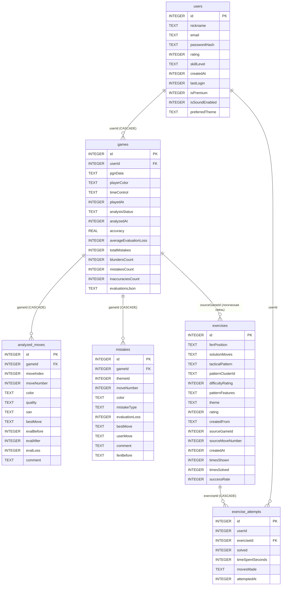

# 04. База данных Room v5, резервное копирование и безопасность

> Навигация: [README](../README.md) · [01. Архитектура](01-architecture.md) · [02. Движок и анализ](02-engine-and-analysis.md) · [03. Тренажёр и аналитика](03-training-and-analytics.md) · **04. БД, бэкап и безопасность** · [05. Руководство пользователя](05-user-guide.md) · [06. Сборка, CI и тесты](06-build-ci-and-testing.md)

---

## 1. База данных Room SQLite (`chess_mentor_db`, версия 5)

- **Класс базы:** [`AppDatabase`](../app/src/main/java/com/example/chessmentor/data/local/AppDatabase.kt) (`version = DatabaseMigrations.CURRENT_VERSION = 5`, `exportSchema = true`).
- **Версионированный снимок схемы:** [`app/schemas/com.example.chessmentor.data.local.AppDatabase/5.json`](../app/schemas/com.example.chessmentor.data.local.AppDatabase/5.json) (`formatVersion = 1`, `identityHash = e6669313aaec13fe33cd8fb60595df48`).
- **Контроль целостности схемы в CI:** при каждом коммите KSP генерирует JSON-схему, а GitHub Actions сверяет её через `git diff --exit-code -- app/schemas/`, блокируя случайные изменения `@Entity` без миграции.

### 1.1. ER-диаграмма



### 1.2. Спецификация всех 6 таблиц и 7 индексов

#### `users` — профили пользователей (11 колонок)
| Колонка | Тип SQLite | Null | Описание |
|---|---|---|---|
| `id` | `INTEGER` | PK (`AUTOINCREMENT`) | Уникальный идентификатор пользователя |
| `nickname` | `TEXT` | `NOT NULL` | Отображаемое имя (`3..50` символов, уникальное) |
| `email` | `TEXT` | `NOT NULL` | Email для входа (уникальный) |
| `passwordHash` | `TEXT` | `NOT NULL` | `pbkdf2_sha256$310000$<saltB64>$<hashB64>` |
| `rating` | `INTEGER` | `NOT NULL` | Текущий тренировочный рейтинг Эло (`100..3500`) |
| `skillLevel` | `TEXT` | `NOT NULL` | `BEGINNER` / `INTERMEDIATE` / `ADVANCED` / `EXPERT` |
| `createdAt` | `INTEGER` | `NOT NULL` | Время регистрации (epoch ms) |
| `lastLogin` | `INTEGER` | `NULL` | Время последнего входа (epoch ms) |
| `isPremium` | `INTEGER` | `NOT NULL` | Зарезервированный флаг (`0` / `1`) |
| `isSoundEnabled` | `INTEGER` | `NOT NULL` | Звуковые эффекты (`0` / `1`) |
| `preferredTheme` | `TEXT` | `NOT NULL` | Тема доски (`Классическая`, `Синяя`, `Зеленая`, `Дерево`) |

#### `games` — библиотека партий (15 колонок)
- **FK:** `userId → users(id) ON DELETE CASCADE`.
- **Индекс:** `index_games_userId (userId)`.
- **Колонки:** `id`, `userId`, `pgnData` (обогащённый PGN), `playerColor` (`WHITE`/`BLACK`), `timeControl`, `playedAt`, `analysisStatus` (`PENDING` / `IN_PROGRESS` / `COMPLETED` / `FAILED`), `analyzedAt`, `accuracy` (`REAL`, точность игрока `0..100`), `averageEvaluationLoss` (ACPL), `totalMistakes`, `blundersCount`, `mistakesCount`, `inaccuraciesCount`, `evaluationsJson` (массив оценок в перспективе белых по всем полуходам).

#### `analyzed_moves` — пошаговый анализ обеих сторон (12 колонок)
- **FK:** `gameId → games(id) ON DELETE CASCADE`.
- **Индекс:** `index_analyzed_moves_gameId (gameId)`.
- **Колонки:** `id`, `gameId`, `moveIndex` (0-based полуход), `moveNumber` (1-based ход), `color`, `quality` (одно из 10 значений `MoveQuality`), `san`, `bestMove` (UCI/SAN сильнейшего хода), `evalBefore`, `evalAfter` (в перспективе белых), `evalLoss` (неотрицательная потеря в сП), `comment` (русское тренерское пояснение).

#### `mistakes` — ошибки игрока (11 колонок)
- **FK:** `gameId → games(id) ON DELETE CASCADE`.
- **Индекс:** `index_mistakes_gameId (gameId)`.
- **Колонки:** `id`, `gameId`, `themeId`, `moveNumber`, `color`, `evaluationLoss`, `mistakeType` (`INACCURACY` / `MISTAKE` / `BLUNDER`), `bestMove`, `userMove`, `comment`, `fenBefore` (позиция до ошибочного хода для мгновенного разбора и генерации задач).

#### `exercises` — кураторские и персональные задачи (16 колонок)
- **Индексы (3):** `index_exercises_tacticalPattern (tacticalPattern)`, `index_exercises_difficultyRating (difficultyRating)`, `index_exercises_patternClusterId (patternClusterId)`.
- **Колонки:** `id`, `fenPosition`, `solutionMoves` (JSON-массив UCI-ходов нечётной длины), `tacticalPattern` (37 значений `TacticalPattern`), `patternClusterId`, `difficultyRating` (`0..100`), `patternFeatures` (JSON-массив признаков и тегов `ExerciseMetadata`: `CURATED_ID:`, `TITLE:`, `PREV_MOVE:`, `PRE_FEN:`, `GOAL:DEFENSE`), `theme` (`TacticalTheme`), `rating` (`800..2400`), `createdFrom` (`MISTAKE`/`IMPORTED`/`GENERATED`/`MANUAL`), `sourceGameId` (`NULL` для общих кураторских задач, ID партии — для персональных), `sourceMoveNumber`, `createdAt`, `timesShown`, `timesSolved`, `successRate` (`0..100`).

#### `exercise_attempts` — история решений и база для SM-2 (7 колонок)
- **FK:** `exerciseId → exercises(id) ON DELETE CASCADE`.
- **Индекс:** `index_exercise_attempts_exerciseId (exerciseId)`.
- **Колонки:** `id`, `userId`, `exerciseId`, `solved` (`0`/`1`), `timeSpentSeconds`, `movesMade` (JSON-массив сделанных UCI-ходов и метатегов `@HINT:*`, `@REVEALED`, `@RETRY:*`, `@FIRST_MS:*`, `@IMPULSE`), `attemptedAt` (epoch ms).

### 1.3. Конвертеры типов (`TypeConverters`)
- `List<String>` сериализуется в экранированный JSON-массив строк (`["e2e4","e7e5","@FIRST_MS:3200"]`), а при чтении сохраняет обратную совместимость со старыми записями через запятую.
- Все 8 перечислений (`SkillLevel`, `ChessColor`, `AnalysisStatus`, `MistakeType`, `MoveQuality`, `TacticalPattern`, `TacticalTheme`, `ExerciseSource`) сохраняются по строковому `name` с безопасными значениями по умолчанию (`GOOD`, `MIXED`, `TACTIC`, `MISTAKE`) при неизвестном токене.

### 1.4. Недеструктивные миграции `1 → 5` и самовосстановление

В [`DatabaseMigrations.kt`](../app/src/main/java/com/example/chessmentor/data/local/DatabaseMigrations.kt) реализована полная цепочка `ALL_MIGRATIONS` без `fallbackToDestructiveMigration`:
- **`MIGRATION_1_2`** — гарантирует базовые таблицы (`users`, `games`, `mistakes`, `exercises`, `exercise_attempts`) и индексы.
- **`MIGRATION_2_3`** — создаёт таблицу `analyzed_moves` и `index_analyzed_moves_gameId`.
- **`MIGRATION_3_4`** — идемпотентно добавляет `games.evaluationsJson`.
- **`MIGRATION_4_5`** — идемпотентно (через проверку `PRAGMA table_info`) добавляет недостающие колонки в `users`, `games`, `mistakes`, `exercises`, пересчитывает `difficultyRating = clamp(((rating - 600) * 100) / 1800, 5, 95)` для ранее созданных задач и создаёт все 7 индексов.

При холодном старте [`DatabaseMaintenance.runStartupChecksOnce()`](../app/src/main/java/com/example/chessmentor/data/local/DatabaseMaintenance.kt) однократно выполняет фоновую санацию:
1. переводит партии, прерванные в статусе `IN_PROGRESS` с уже готовыми `accuracy` и `evaluationsJson`, в `COMPLETED`, а незавершённые — обратно в `PENDING`;
2. удаляет осиротевшие персональные задачи, чей `sourceGameId` ссылается на удалённую партию;
3. устраняет случайные дубликаты в глобальном кураторском банке.

---

## 2. Локальные настройки (`SharedPreferences`) и файловая система

| Хранилище | Путь в песочнице приложения | Ключи / содержимое |
|---|---|---|
| `SharedPrefsSessionRepository` | `shared_prefs/user_session.xml` | `active_user_id` (`Long`, `-1L` если не авторизован), `last_login_email` (`String`), `app_theme_mode` (`system` / `light` / `dark`), `chess_username_hint_<userId>` (игровой ник на Lichess/Chess.com для автоопределения цвета). |
| `SharedPrefsEngineSettingsRepository` | `shared_prefs/engine_settings.xml` | `depth` (`10..25`), `threads` (`1..8`), `hash_size` (`16..256`). |
| `NnueDownloader` | `files/nnue/nn-1a298aa575a0.nnue` | Проверенный SHA-256 файл весов нейросети Stockfish 19 (временный файл при загрузке — `*.part`). |

---

## 3. Переносимое резервное копирование (JSON SHA-256 и PGN)

### 3.1. Полный JSON-бэкап (`UserProgressBackupCodec`, `schemaVersion = 1`)

Модули: [`SimpleJson.kt`](../app/src/main/java/com/example/chessmentor/domain/backup/SimpleJson.kt), [`UserProgressBackupCodec.kt`](../app/src/main/java/com/example/chessmentor/domain/backup/UserProgressBackupCodec.kt), [`ExportUserBackupUseCase.kt`](../app/src/main/java/com/example/chessmentor/domain/usecase/ExportUserBackupUseCase.kt), [`ImportUserBackupUseCase.kt`](../app/src/main/java/com/example/chessmentor/domain/usecase/ImportUserBackupUseCase.kt).

Имя файла по умолчанию: `chessmentor_backup_<nickname>_YYYY-MM-DD.json`. Структура конверта:

```json
{
  "format": "chessmentor.user_backup",
  "schemaVersion": 1,
  "exportedAtMs": 1794916800000,
  "checksumSha256": "<64 hex-символа SHA-256 от канонического компактного payload>",
  "payload": {
    "profile": {
      "nickname": "Player",
      "rating": 1480,
      "preferredBoardTheme": "Классическая",
      "isSoundEnabled": true,
      "appThemeMode": "system",
      "chessUsernameHint": "player_lichess",
      "engineSettings": { "depth": 15, "threads": 2, "hashSizeMb": 32 }
    },
    "games": [
      {
        "pgnData": "...",
        "playerColor": "WHITE",
        "timeControl": "180+2",
        "playedAt": 1794830400000,
        "analysisStatus": "COMPLETED",
        "accuracy": 89.4,
        "averageEvaluationLoss": 26,
        "evaluationsJson": "[20,18,25,...]",
        "analyzedMoves": [ ... ],
        "mistakes": [ ... ]
      }
    ],
    "personalExercises": [
      {
        "fenPosition": "...",
        "solutionMoves": ["c1g5"],
        "tacticalPattern": "PIN_ABSOLUTE",
        "sourceGameIndex": 0,
        "sourceMoveNumber": 8,
        ...
      }
    ],
    "attempts": [
      {
        "curatedId": "smothered_mate_philidor",
        "personalExerciseIndex": null,
        "solved": true,
        "timeSpentSeconds": 9,
        "movesMade": ["f7h6", "g8h8", "d5g8", "e8g8", "h6f7", "@FIRST_MS:6500"],
        "attemptedAt": 1794900000000
      }
    ]
  }
}
```

#### Гарантии безопасности и идемпотентности восстановления
- **Защита от повреждений и подмены:** `checksumSha256` вычисляется по детерминированной компактной сериализации `SimpleJson.stringify(payload, pretty = false)` с сохранением порядка полей (`LinkedHashMap`). Изменение любого символа внутри `payload` отклоняется до записи в БД.
- **Защита от DoS на входе:** и потоковое чтение SAF в `SettingsScreen`, и парсер `SimpleJson` ограничивают размер входа **16 МБ** (`MAX_INPUT_CHARS = 16 * 1024 * 1024`), а глубину вложенности — **32** уровнями (`MAX_NESTING_DEPTH = 32`); числа `NaN`/`Infinity` запрещены, суррогатные пары UTF-16 обрабатываются по RFC 8259.
- **Отсутствие секретов:** `passwordHash`, `email` и `active_user_id` не входят в снимок — копию можно безопасно хранить в облаке и переносить между разными локальными аккаунтами и устройствами.
- **Умное слияние без дублей (`ImportUserBackupUseCase`):**
  - партии сопоставляются по отпечатку `PgnParser`; уже имеющиеся пропускаются, но если локальная копия была в статусе `PENDING`/`FAILED`, а в бэкапе она `COMPLETED`, выполняется автоматический **апгрейд анализа** (дозаписываются оценки, `AnalyzedMove` и `Mistake`);
  - персональные задачи перепривязываются к новым `sourceGameId` по `sourceGameIndex` и дедуплицируются по `(fenPosition, solutionMoves)`;
  - попытки `attempts` связываются с кураторскими задачами по стабильному `curatedId` и с персональными по `personalExerciseIndex`, дедуплицируются по ключу `(exerciseId, attemptedAt, solved, timeSpentSeconds, movesMade)`, полностью сохраняя расписание **SM-2**, после чего счётчики `timesShown`/`timesSolved`/`successRate` пересчитываются.

### 3.2. Экспорт мульти-партийного архива `.pgn` (`PgnArchiveExporter`)
- Экспортирует все партии пользователя (от новых к старым) в единый UTF-8 файл `chessmentor_<nick>_YYYY-MM-DD.pgn`.
- Для партий без заголовков автоматически формирует валидные теги `[Event]`, `[Date]`, `[White]`, `[Black]`, канонический `[TimeControl]` в секундах и завершающий токен результата (`1-0`, `0-1`, `1/2-1/2`, `*`).
- Совместим с Lichess, Chess.com, ChessBase и повторным импортом в ChessMentor без потерь.

---

## 4. Безопасность, аутентификация и правила Android Backup

### 4.1. Хеширование паролей (`PasswordHasher`)
- **Алгоритм:** `PBKDF2WithHmacSHA256` (стандартный JCE, без сторонних криптобиблиотек).
- **Параметры (рекомендация OWASP):** `310 000` итераций, случайная соль `16 байт` (`SecureRandom`), выходной ключ `256 бит`.
- **Формат хранения:** `pbkdf2_sha256$310000$<base64(salt)>$<base64(derivedKey)>`.
- **Гигиена памяти и тайминг-атак:** массив символов пароля в `PBEKeySpec` очищается в блоке `finally` (`spec.clearPassword()`), а сравнение хешей выполняется за постоянное время через `MessageDigest.isEqual`.
- **Миграция старых записей:** при входе (`LoginUserUseCase`) и смене пароля (`ChangePasswordUseCase`) устаревший формат `hashed_*` распознаётся и прозрачно перезаписывается в `PBKDF2-HMAC-SHA256`.

### 4.2. Изоляция пользователей и удаление аккаунта
- Партии, ходы, ошибки, персональные задачи и попытки строго фильтруются по `userId`. Общим между локальными профилями на одном устройстве является только неизменяемый кураторский банк (`sourceGameId IS NULL`).
- При удалении аккаунта каскадные внешние ключи `ON DELETE CASCADE` удаляют все партии, `analyzed_moves` и `mistakes`, явно очищаются персональные задачи, `exercise_attempts` и ключи `user_session.xml`.

### 4.3. Правила Android Auto Backup и Device Transfer

Файлы [`res/xml/backup_rules.xml`](../app/src/main/res/xml/backup_rules.xml) (Android 10–11) и [`res/xml/data_extraction_rules.xml`](../app/src/main/res/xml/data_extraction_rules.xml) (Android 12+):

| Домен и путь | Облачный бэкап (`cloud-backup`) | Перенос на новое устройство (`device-transfer`) | Причина |
|---|---|---|---|
| `file/nnue` | Исключён | Исключён | Файл нейросети (~70–100 МБ) превышает квоту Auto Backup и перекачивается с проверкой SHA-256. |
| `database/.` | Исключён | Разрешён | Локальная БД с хешами паролей не выгружается автоматически в облако (для облака предназначен явный JSON-бэкап без хешей). |
| `sharedpref/user_session.xml` | Исключён | Исключён | Активная сессия не переносится без повторного ввода пароля. |
| `sharedpref/engine_settings.xml` | Разрешён | Разрешён | Безопасные пользовательские параметры `depth`/`threads`/`hash`. |
