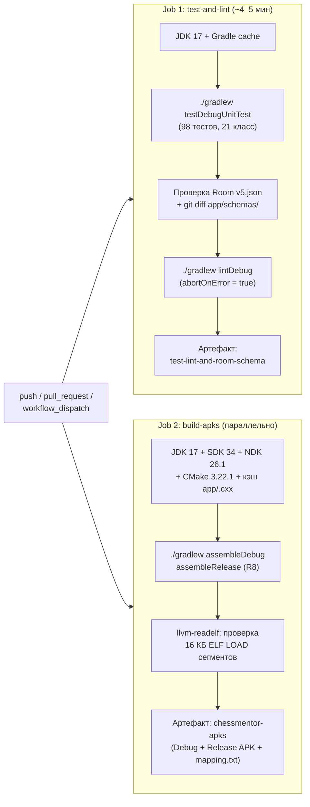

# 06. Сборка, CI/CD, релиз (R8) и тестирование

> Навигация: [README](../README.md) · [01. Архитектура](01-architecture.md) · [02. Движок и анализ](02-engine-and-analysis.md) · [03. Тренажёр и аналитика](03-training-and-analytics.md) · [04. БД, бэкап и безопасность](04-database-backup-and-security.md) · [05. Руководство пользователя](05-user-guide.md) · **06. Сборка, CI и тесты**

---

## 1. Среда разработки и матрица версий

Конфигурация зафиксирована в [`gradle/wrapper/gradle-wrapper.properties`](../gradle/wrapper/gradle-wrapper.properties), [`gradle/libs.versions.toml`](../gradle/libs.versions.toml), [`settings.gradle.kts`](../settings.gradle.kts) и [`app/build.gradle.kts`](../app/build.gradle.kts):

- **JDK:** `17` (`sourceCompatibility = targetCompatibility = JavaVersion.VERSION_17`, `jvmTarget = "17"`) + `com.android.tools:desugar_jdk_libs:2.0.4` (для `java.time.*` и современных API JDK на всех версиях Android).
- **Gradle / AGP / Kotlin / KSP:** Gradle `8.5`, AGP `8.2.2`, Kotlin `2.0.0` (со встроенным плагином `org.jetbrains.kotlin.plugin.compose`), KSP `2.0.0-1.0.21`.
- **Android SDK:** `compileSdk = 34`, `targetSdk = 34`, `minSdk = 29`, Build-Tools `34.0.0`.
- **Нативный тулчейн:** Android NDK `26.1.10909125`, CMake `3.22.1`, целевые ABI `arm64-v8a` и `x86_64`.
- **Репозитории зависимостей:** `google()`, `mavenCentral()`, `https://jitpack.io` (для `com.github.bhlangonijr:chesslib:1.3.3`; режим `FAIL_ON_PROJECT_REPOS`).

### Основные команды Gradle

| Команда | Что выполняет |
|---|---|
| `./gradlew testDebugUnitTest` | Компилирует проект, генерирует KSP-код и схему Room v5, запускает все 98 JVM unit-тестов (NDK не требуется). |
| `./gradlew lintDebug` | Запускает Android Lint (`abortOnError = true`) и формирует HTML/XML-отчёты в `app/build/reports/`. |
| `./gradlew assembleDebug` | Собирает `libstockfish-lib.so` (для `arm64-v8a` и `x86_64`) и отладочный `app-debug.apk`. |
| `./gradlew assembleRelease` | Собирает R8-минифицированный и сжатый `app-release-unsigned.apk` + `app/build/outputs/mapping/release/mapping.txt`. |
| `./gradlew connectedDebugAndroidTest` | Запускает инструментальные тесты на подключённом устройстве/эмуляторе (с доступом к JSON-схемам Room из `app/schemas/`). |

---

## 2. Нативная сборка Stockfish 19 и совместимость с Android 15+ (16 КБ)

- Исходники Stockfish `sf_19` расположены в `app/src/main/cpp/stockfish/src/` (удалены только неиспользуемые на Android `main.cpp`, `universal/` и `Makefile`).
- Сборка управляется [`app/src/main/cpp/CMakeLists.txt`](../app/src/main/cpp/CMakeLists.txt): компилируются 25 исходных файлов ядра Stockfish (включая подсистему NNUE `half_ka_v2_hm`, `full_threats`, `pp_3wide` и `syzygy/tbprobe`) вместе с `stockfish_bridge.cpp` и `stockfish_jni.cpp`.
- Опция линковщика `"-Wl,-z,max-page-size=16384"` гарантирует выравнивание всех сегментов `PT_LOAD` в `libstockfish-lib.so` по границе `0x4000` (16 КБ) для обоих ABI (`arm64-v8a` и `x86_64`), обеспечивая запуск на устройствах Android 15+ с 16-КБ страницами памяти и соответствие требованиям Google Play.

Проверка выравнивания вручную:

```bash
"$ANDROID_HOME/ndk/26.1.10909125/toolchains/llvm/prebuilt/linux-x86_64/bin/llvm-readelf" -l \
  app/build/intermediates/merged_native_libs/release/out/lib/arm64-v8a/libstockfish-lib.so | grep LOAD
```

### Обновление версии сети NNUE (при апгрейде Stockfish)
1. Проверьте значение `EvalFileDefaultNameBig` в `app/src/main/cpp/stockfish/src/evaluate.h`.
2. Обновите константы `NET_NAME` и `EXPECTED_SHA256_PREFIX` в [`NnueIntegrity`](../app/src/main/java/com/example/chessmentor/domain/engine/EngineStatus.kt).
3. Прогоните `EngineStatusAndNnueTest` (`./gradlew testDebugUnitTest --tests "*EngineStatusAndNnueTest"`).

---

## 3. Релизная сборка, R8/ProGuard и подпись

В `buildTypes.release` включены полная оптимизация и обфускация кода **`isMinifyEnabled = true`** (`proguard-android-optimize.txt` + [`app/proguard-rules.pro`](../app/proguard-rules.pro)) и удаление неиспользуемых ресурсов **`isShrinkResources = true`**.

**Эффект оптимизации (по артефактам CI):**
- `app-debug.apk` — **67.69 МБ**;
- `app-release-unsigned.apk` — **8.99 МБ** (сокращение размера на **86.7%**, при этом внутри включены обе нативные сборки Stockfish 19 для `arm64-v8a` и `x86_64`).

### Назначение правил `app/proguard-rules.pro`
1. **Диагностика и деобфускация:** `-keepattributes SourceFile,LineNumberTable,Signature,InnerClasses,EnclosingMethod,*Annotation*` и `-renamesourcefileattribute SourceFile` сохраняют читаемые номера строк для расшифровки стектрейсов через `retrace` и `mapping.txt`.
2. **JNI-мост Stockfish:** сохраняются имя класса `com.example.chessmentor.data.engine.StockfishEngine` и все его `native`-методы, связываемые по символам `Java_com_example_chessmentor_data_engine_StockfishEngine_native*` в `stockfish_jni.cpp`.
3. **Room и KSP:** сохраняются наследники `RoomDatabase`, сгенерированные `*_Impl` (загружаемые через `Class.forName`), конструкторы и поля `@Entity` (`domain.entity.**`), DAO и методы `TypeConverters`.
4. **Перечисления проекта:** сохраняются `values()`, `valueOf(String)` и `getEntries()` у `enum` в `com.example.chessmentor.**` (используются в `TypeConverters`, маршрутах и JSON-бэкапе).
5. **`chesslib`:** сохраняются классы `com.github.bhlangonijr.chesslib.**` (включая enum-типы клеток `Square`, фигур `Piece`/`PieceType` и сторон `Side`, использующие `fromValue`/`valueOf`).

### Подпись релизного APK для публикации
Хранилища ключей (`*.jks`, `*.keystore`, `.signing/`) исключены из Git через `.gitignore`. Подписать собранный `app-release-unsigned.apk` можно стандартными утилитами Build-Tools:

```bash
"$ANDROID_HOME/build-tools/34.0.0/zipalign" -p -f -v 4 \
  app/build/outputs/apk/release/app-release-unsigned.apk \
  app-release-aligned.apk

"$ANDROID_HOME/build-tools/34.0.0/apksigner" sign \
  --ks /path/to/release.jks \
  --out chessmentor-release.apk \
  app-release-aligned.apk

"$ANDROID_HOME/build-tools/34.0.0/apksigner" verify --verbose chessmentor-release.apk
```

Обязательно сохраняйте файл `app/build/outputs/mapping/release/mapping.txt` вместе с каждым опубликованным релизом для деобфускации отчётов о сбоях.

---

## 4. Непрерывная интеграция — GitHub Actions CI

Файл воркфлоу: [`.github/workflows/android-ci.yml`](../.github/workflows/android-ci.yml). Запускается на `push` (`master`, `arena/**`), на всех `pull_request` в `master` и вручную (`workflow_dispatch`); использует минимальные права `contents: read` и отмену устаревших прогонов (`cancel-in-progress: true`).



При сбое любого шага встроенные парсеры логов формируют точные аннотации `::error file=...,line=...::` для ошибок компилятора Kotlin, KSP, NDK/Clang, R8, Android Lint и упавших JUnit-тестов прямо во вкладке **Checks / Files changed** Pull Request'а.

---

## 5. Каталог модульных тестов (21 класс, 98 тестов)

Все модульные тесты расположены в `app/src/test/java/com/example/chessmentor/` и выполняются на чистой JVM за несколько секунд без эмулятора (`testOptions.unitTests.isReturnDefaultValues = true`).

| Подсистема | Тестовый класс | Тестов | Что проверяется |
|---|---|---:|---|
| **Анализ ходов и партий** | `domain/analysis/GameMoveClassifierTest` | 10 | Кривая `Win%`, пороги всех категорий качества, форсированные маты, жертвы `BRILLIANT` (греческий дар, мат Легаля vs обычные размены), `GREAT_MOVE` и отсев автоматических обратных взятий, дебютная книга и перестановки, двусторонняя точность, монотонность фаз. |
| | `domain/analysis/SemanticMistakeAnalyzerTest` | 3 | Детекция тактических мотивов (вилки, связки, маты, незащищённые фигуры) и категорий ошибок. |
| | `domain/analysis/GameReviewHelperTest` | 4 | Подсчёт материального баланса, режим «Исправить ошибку», разбор продолжений и ключевых моментов. |
| | `domain/entity/AnalyzedMoveAndScoreTest` | 6 | Форматирование сантипешек и матовых оценок (`+M3`, `-M`), инварианты `AnalyzedMove` и `ChessEngine.Companion`. |
| **Дебюты, PGN и правила** | `domain/opening/OpeningDatabaseTest` | 3 | Точный и структурный поиск дебютов ECO, отсутствие ложного срабатывания на стартовой позиции. |
| | `domain/pgn/PgnParserAndUploadTest` | 5 | Мульти-PGN разбиение, метаданные и часы `[%clk]`, отклонение нелегальных ходов и экзотических вариантов, контроли времени (секунды/минуты/заочные), автоопределение цвета и дедупликация в `UploadGameUseCase`. |
| | `domain/util/ChessMoveUtilsTest` | 6 | Конвертация UCI ↔ SAN (рокировки, превращения в `Q`/`N`/`R`), строгая проверка легальности и превращения пешки, очистка вложенных вариантов, комментариев, NAG и сохранение `[FEN]`. |
| **Тренажёр, SM-2 и Эло** | `domain/training/TrainingRatingCalculatorTest` | 12 | Симметрия и отсутствие инфляции Эло, калибровочный `K = 40/28/22`, штрафы за подсказки, дорешивание и перебор ходов, пороги импульсивности по режимам, обрезка PV, расчёт `PatternMastery` с затуханием давности. |
| | `domain/training/SpacedRepetitionSchedulerTest` | 5 | Кодирование/чтение `AttemptMetadata`, объединение попыток в 10-минутные подходы, переходы коробок `0..5` и `easeFactor` SM-2, ранжирование просроченных карточек. |
| | `domain/training/CuratedExerciseBankTest` | 5 | Валидность FEN и легальность всех ходов во всех 46 кураторских задачах, уникальность `CURATED_ID`, наличие задач за обе стороны, превращение в коня, детерминизм «Задачи дня». |
| | `domain/training/TrainingUseCasesTest` | 5 | Изоляция персональных задач между пользователями, фильтрация по режимам и темам, интеграция `GenerateExercisesFromMistakesUseCase` и `GetTrainingExerciseUseCase`. |
| | `domain/training/PuzzleQualityEvaluatorTest` | 3 | Отсев безнадёжных и разгромных позиций, распознавание защитных задач и обрезка варианта в «тихой» точке. |
| | `domain/training/TrainingSessionPlannerTest` | 3 | Распределение 4 фаз «Сессии 10», чередование `InterleavedPatternQueue` (`+2` / `+5`) и расчёт итоговой сводки сессии. |
| | `domain/training/SolutionReviewTest` | 3 | Пошаговая реконструкция и объяснение решения задачи. |
| **Статистика** | `domain/statistics/PlayerAnalyticsCalculatorTest` | 5 | Статистика по цветам (W/D/L, счёт, ACPL, лучший Эло), репертуар ECO, фазы, цейтнот, наказание зевков, срезы по периодам, тренд точности, кривая Эло, 14-дневная серия и `GetUserStatisticsUseCase`. |
| **БД, сессия, бэкап, безопасность** | `domain/backup/UserProgressBackupTest` | 4 | Парсер `SimpleJson` (экранирование, суррогаты UTF-16, лимит глубины), проверка `SHA-256` и версии схемы, отсутствие `passwordHash`, сквозное восстановление в новый профиль с сохранением SM-2, идемпотентность повторного импорта и апгрейд `PENDING → COMPLETED`. |
| | `domain/security/PasswordHasherTest` | 6 | Генерация уникальной соли, верификация `PBKDF2-HMAC-SHA256`, отказ на повреждённых строках, миграция `hashed_*` при входе и смена пароля. |
| | `domain/session/SessionAuthAndBackupTest` | 3 | Режимы темы `AppThemeMode`, состояния сессии и сквозной экспорт/повторный импорт мульти-PGN в `PgnArchiveExporter`. |
| | `data/local/TypeConvertersTest` | 3 | Round-trip JSON-списков со спецсимволами, совместимость с CSV и устойчивость enum-конвертеров к неизвестным значениям. |
| **Движок и NNUE** | `domain/engine/EngineStatusAndNnueTest` | 3 | Потоковая проверка префикса `SHA-256`, расчёт свободного места, классификация сетевых/HTTP/дисковых ошибок и форматирование `EngineStatus`. |
| **Базовый smoke-тест** | `ExampleUnitTest` | 1 | Проверка работоспособности тестового раннера JUnit 4. |

---

## 6. Руководство и чек-листы для разработчика

### 6.1. Как безопасно изменить схему БД Room
1. Внесите изменения в `@Entity` и при необходимости в `TypeConverters` / DAO.
2. Увеличьте `DatabaseMigrations.CURRENT_VERSION` (например, `5 → 6`) в `DatabaseMigrations.kt`.
3. Добавьте идемпотентную миграцию `MIGRATION_5_6` (с проверкой `hasColumn` / `IF NOT EXISTS`) и включите её в массив `ALL_MIGRATIONS`.
4. При необходимости обновите `UserProgressBackupCodec` (с сохранением обратной совместимости чтения `schemaVersion = 1`) и `DatabaseMaintenance`.
5. Запустите `./gradlew testDebugUnitTest` и закоммитьте сгенерированный файл `app/schemas/com.example.chessmentor.data.local.AppDatabase/6.json` (старый `5.json` не удаляйте — он нужен для истории миграций).

### 6.2. Как добавить задачи в кураторский банк или дебюты в книгу
- **Новая кураторская задача:** добавьте `CuratedPuzzle` в `CuratedExerciseBank.kt` с уникальным `id`, валидным FEN и нечётным списком UCI-ходов `solutionMoves` (для слабого превращения указывайте 5-й символ `n`/`r`/`b`). Запустите `CuratedExerciseBankTest` — он автоматически проверит легальность всех ходов на доске.
- **Новая дебютная табия или линия:** добавьте `OpeningPosition` или `CanonicalBookLine` в `OpeningDatabase.kt` (ходы в стандартном SAN от начальной позиции) и проверьте через `OpeningDatabaseTest` и `GameMoveClassifierTest`.

### 6.3. Правила кода и совместимости
- **Совместимость с `minSdk = 29` (Android 10):** не используйте методы JDK 11–21, отсутствующие в Android API 29 и не покрытые `desugar_jdk_libs` (например, `InputStream.readNBytes`/`readAllBytes`/`transferTo`, `java.util.HexFormat`, `String.formatted`, `Math.clamp`); для новых атрибутов Android XML указывайте `tools:targetApi`.
- **Регулярные выражения под Android ICU:** всегда экранируйте закрывающую скобку `\]` и фигурные скобки внутри символьных классов `[...]`.
- **Проверка легальности ходов `chesslib`:** всегда используйте `ChessMoveUtils.isStrictlyLegal(board, move)` вместо `board.isMoveLegal(move, true)` (последний проверяет только шах своему королю), а при разборе SAN через `MoveList` создавайте `MoveList(board.fen)` с `addSanMove(san, replay = true, fullValidation = true)`.
- **Кодировка файлов:** сохраняйте все исходники и ресурсы XML в чистом UTF-8 без BOM.
